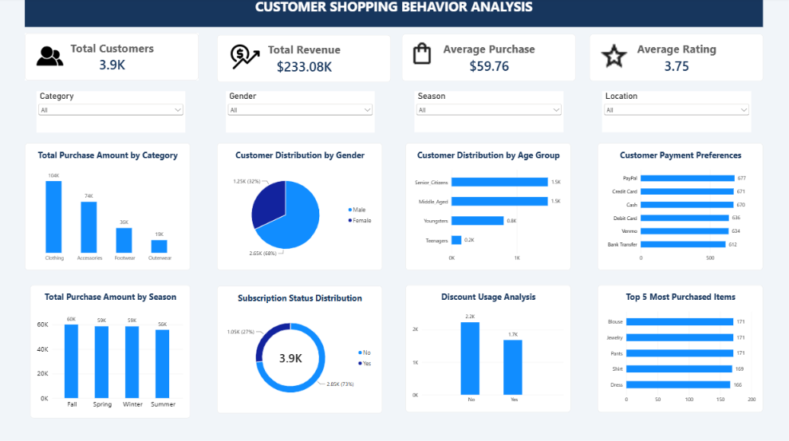

## 📊 Customer Shopping Behavior Analysis

### Overview

The Customer Shopping Behavior Analysis project provides insights into customer purchasing patterns, shopping preferences, product performance, and seasonal trends. It helps understand customer behavior, analyze sales patterns, and identify meaningful business insights using data analytics.

### Key Highlights

- Analyzes customer purchasing patterns and shopping trends.
- Explores customer demographics based on gender and age groups.
- Evaluates purchase amounts across different product categories.
- Analyzes seasonal shopping patterns and discount usage.
- Identifies customer payment method preferences.
- Highlights the top 5 most purchased products.
- Provides an interactive Power BI dashboard with filters for better data exploration.

### Dashboard Preview

### Technologies Used

- **Python:** Data cleaning, preprocessing, and exploratory data analysis.
- **MySQL:** Data storage, querying, and analysis.
- **Excel:** Data preparation and validation.
- **Power BI:** Interactive dashboard development and visualization.

### Objective

The main goal of this project is to transform raw customer shopping data into meaningful insights, understand purchasing behavior, identify shopping trends, and support data-driven business decisions.

An end-to-end data analytics project designed to make customer behavior analysis easier, more insightful, and effective.
